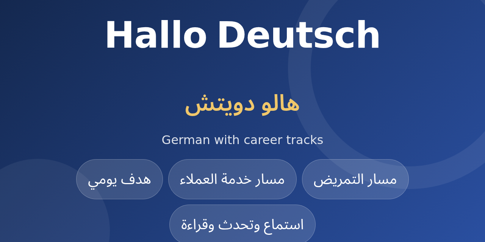

<b><a href="https://hallo-deutsch-1bu.pages.dev">Open the app | افتح التطبيق</a></b> Web app · Arabic interface · Early version

## عن التطبيق

تطبيق ويب لتعلّم الألمانية بالعربية مع مسارات مهنية للتمريض (Pflege) وخدمة العملاء (Call Center). استماع وتحدث وقراءة، وهدف يومي (5 أو 10 أو 20 دقيقة) وسلسلة أيام. يتضمن 63 مقطعًا صوتيًا مسجّلاً، وصوت الجهاز عند غياب المقطع.

> **حدود النسخة الحالية:** نسخة مبكرة. الصفحة تذكر مستويات من A1 إلى C1، لكن لم يتم التحقق من منهج كامل في كل مستوى. لم يُجرَّب على هاتف حقيقي، ولم يراجعه مدرّس ألماني.

## About

A web app for learning German in Arabic, with career tracks for nursing (Pflege) and customer service (call center). Listening, speaking and reading, a daily goal (5, 10 or 20 minutes) and a streak. Includes 63 recorded audio clips; the device voice is used where a clip is missing.

> **Current limits:** Early version. The app mentions levels from A1 to C1, but a full curriculum at every level is not verified. Not tried on a real phone. Not reviewed by a German teacher.

## Features | المزايا

| Feature | الميزة |
| --- | --- |
| Nursing track | مسار التمريض |
| Customer service track | مسار خدمة العملاء |
| Daily goal: 5, 10 or 20 minutes | هدف يومي: 5 أو 10 أو 20 دقيقة |
| Listening, speaking, reading | استماع وتحدث وقراءة |

## Updates

See [CHANGELOG.md](CHANGELOG.md).

Source code is not published in this repository.
